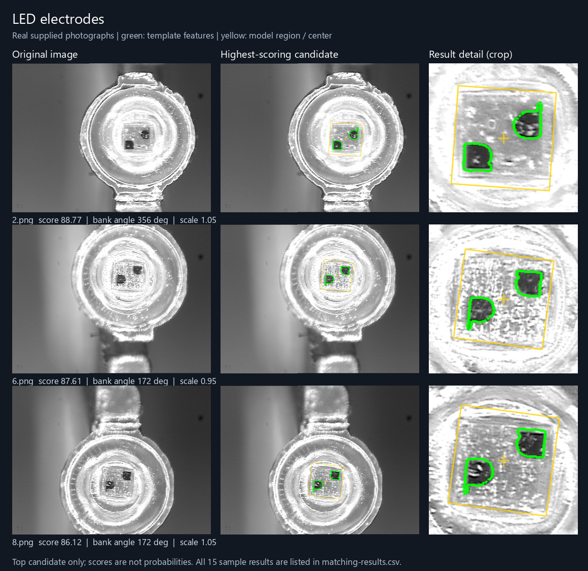
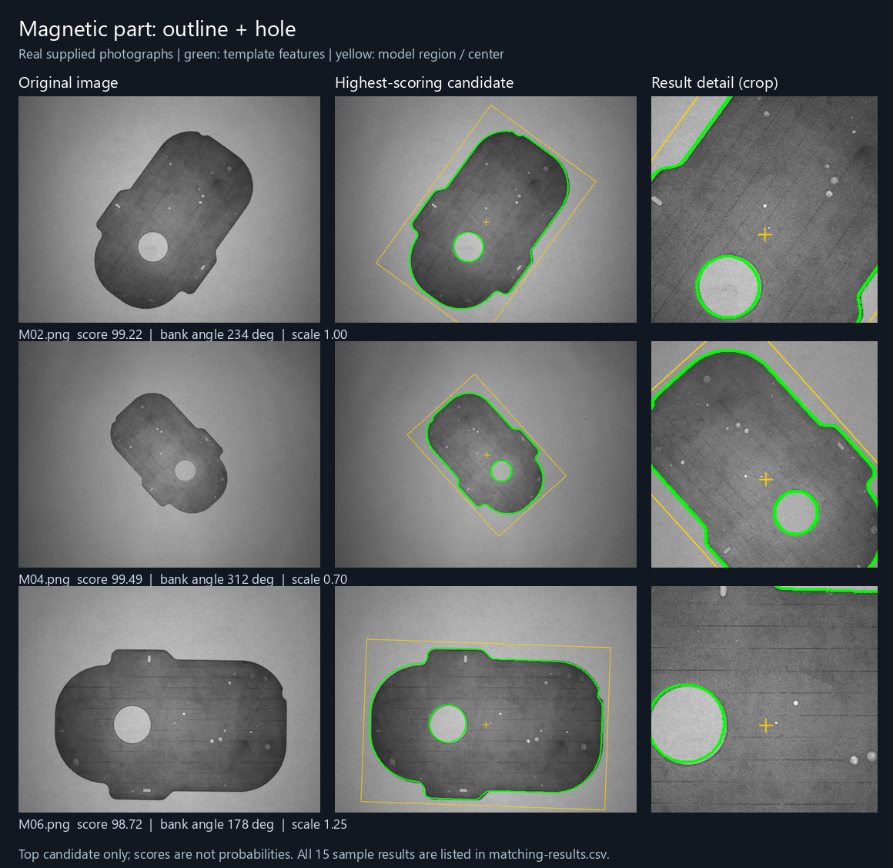

# Shape-based matching

[English](README.md) | [简体中文](README.zh-CN.md)

A C++ library for locating rigid objects by their edge layout. It extracts sparse gradient-orientation features from a template, searches an image pyramid, and returns position, similarity, class ID and template ID. It can be useful when shape is more stable than texture.

The core retains the project's V11 matching behavior. The repository provides the library and reproducible examples; configure and validate matching for your own parts. **v0.1.1** adds real-image examples and architecture documentation. See the [v0.1.1 release](https://github.com/Mossener/shape-based-matching-industrial/releases/tag/v0.1.1).

Read the [architecture and algorithms](docs/architecture.md) ([中文](docs/architecture.zh-CN.md)) for complete diagrams, scoring, search, integration constraints and directions for further optimization.

## Real-image examples

These examples use the project's supplied LED and magnetic-part photographs. Both pose banks cover a full turn in 2° steps, with a matching score threshold of `75`.

| Sample | Images (template source + other) | Pose templates | Best score range on other images |
| --- | --- | --- | --- |
| LED | 8 (1 + 7) | 900 | 86.02–93.54 |
| Magnetic part | 7 (1 + 6) | 3,060 | 89.70–99.49 |

Each comparison shows three non-source development images: original photograph, highest-scoring candidate overlay, and an enlarged result crop. Green marks template features; yellow marks the model region and center, **not ground truth**.

**LED: two central electrodes**



**Magnetic part: outer contour and central hole**



Only the highest-scoring candidate is drawn for each image with a result. CSV files retain the candidates returned by the matching API; their count is **not an object count**. Scores are not probabilities.

The template-source images, `led/1.png` and `magnet/M01.png`, are included in the 15 searched images. The other 13 images have also been used during development. There is no held-out test set, complete independent ground truth or dedicated negative-image evaluation. See [sample sources, settings, timings and all image results](docs/matching-examples.md) and the [demo source](examples/showcase.cpp) for details. Reproduce them with `showcase_example` below.

## Capabilities and limits

- Grayscale or color images, template masks, multiple classes and multiple templates.
- Coarse-to-fine search with eight gradient orientations, reusable work buffers and optional stage timings.
- Optional SIMD and OpenMP acceleration. Applications control their own thread counts.
- Rotation and scale coverage through a **prebuilt pose template bank**. A single template does not provide arbitrary rotation or scale invariance; retain pose metadata alongside template IDs.

Similarity is a normalized gradient-response score on a 0–100 scale, **not a probability or calibrated confidence**. Choose thresholds using representative positive and negative images. Clutter, occlusion, weak edges, symmetry and poses outside the template bank can cause false matches or misses.

Results are discrete candidates. The library does not provide general subpixel localization, continuous angle/scale refinement, a universal SMD/CAD importer or application-level spatial NMS. Its duplicate consolidation does not replace overlap suppression for multiple-object detection. No general industrial accuracy or cycle-time guarantee is implied.

## Build

Requirements:

- CMake 3.16 or newer and a C++14 compiler.
- OpenCV 4 with `core`, `imgproc`, `highgui` and `imgcodecs` development components.
- Bundled MIPP headers; OpenMP is optional.

Python is not required to build or run the library and examples.

Configure and build from the repository root:

```sh
cmake -S . -B build -DCMAKE_BUILD_TYPE=Release
cmake --build build --config Release
```

If CMake cannot locate OpenCV, add `-DOpenCV_DIR=/path/to/opencv/cmake` to the first command. This directory must contain `OpenCVConfig.cmake`; on Windows, use a compatible compiler and OpenCV build, and make its runtime DLLs available through `PATH`.

| CMake option | Purpose |
| --- | --- |
| `SBM_ENABLE_SIMD` | Enable SIMD; x86 GCC/Clang builds use SSE4.1 by default and require a compatible CPU. |
| `SBM_ENABLE_OPENMP` | Enable optional OpenMP template-search parallelism when available. Defaults to OFF on MSVC; enabling it with MSVC is currently unsupported and rejected by CMake. |
| `SBM_BUILD_EXAMPLE` | Build the `match_example` and `showcase_example` command-line programs. |

For a scalar build, configure with `-DSBM_ENABLE_SIMD=OFF`. To disable OpenMP, use `-DSBM_ENABLE_OPENMP=OFF`.

Development has used Windows with GCC and OpenCV 4. Linux, MSVC and ARM builds are not claimed as validated by this release.

## Run the examples

To reproduce the real-image examples, create an output directory and run from the repository root:

```sh
mkdir showcase-output
build/showcase_example examples/data showcase-output
```

`showcase_example` builds pose banks from the saved contours in the included sample SMD models, then writes visualizations and candidate CSV files for the LED and magnet images. Its SMD reader handles the verified layout of these two sample models; it is not a general SMD importer.

On Windows, use `build/showcase_example.exe`. A multi-configuration generator commonly places it at `build/Release/showcase_example.exe`; the same path convention applies to `match_example`.

For a self-contained synthetic check with no image files, run:

```sh
build/match_example --synthetic
```

To train one template from an image and search another image:

```sh
build/match_example template.png scene.png
build/match_example template.png scene.png 85 matches.png
```

The command-line syntax is:

```text
match_example --synthetic
match_example TEMPLATE SCENE [THRESHOLD] [OUTPUT]
```

The `match_example` threshold defaults to `85`. This program handles query padding and alignment automatically and prints the raw returned candidates. `OUTPUT` optionally saves a visualization. Its reported boxes describe the **cropped feature extent in scene coordinates**, not a segmented object boundary or an annotated ground-truth box. Candidates may overlap; `match_example` is not a general NMS pipeline. It demonstrates one supplied pose, so rotated or differently sized objects need a pose bank in your application.

## Use the library

The build exposes the static target `shape_based_matching` and its alias `shape_based_matching::shape_based_matching`. From a parent CMake project:

```cmake
add_subdirectory(path/to/shape_based_matching)
target_link_libraries(my_app PRIVATE shape_based_matching::shape_based_matching)
```

Alternatively, install the built library:

```sh
cmake --install build --config Release --prefix /path/to/install
```

An external CMake project can then use:

```cmake
find_package(shape_based_matching CONFIG REQUIRED)
target_link_libraries(my_app PRIVATE shape_based_matching::shape_based_matching)
```

Configure that project with `-DCMAKE_PREFIX_PATH=/path/to/install` to locate the installation prefix. OpenCV must also be discoverable by CMake.

Include `line2Dup.h`. A typical integration trains or loads templates once, then reuses a workspace across frames:

```cpp
#include "line2Dup.h"
#include <stdexcept>

line2Dup::Detector detector(32, {4, 8}, 20.0f, 40.0f);
const int id = detector.addTemplate(template_image, "part", template_mask);
if (id < 0)
    throw std::runtime_error("Not enough template features");

line2Dup::MatchWorkspace workspace;
line2Dup::MatchOptions options;
line2Dup::MatchTimings timings;
auto matches = detector.match(prepared_scene, 85.0f, workspace,
                              options, &timings);
```

Here the images are application-supplied `CV_8UC1` grayscale or `CV_8UC3` BGR matrices, and `template_mask` is a same-size `CV_8UC1` mask. A template mask selects feature locations; it is not an object detector. Provide sufficient query padding and pyramid alignment for the **whole template bank**; `match_example` demonstrates this preparation for its single template.

Each match contains `x`, `y`, `similarity`, `class_id` and `template_id`. Position refers to the cropped template feature origin in the supplied query. If the query was padded, subtract that padding when converting to original-image coordinates. Use `getTemplates(class_id, template_id)` and saved pose/object metadata to interpret the feature extent or construct an application-specific object box. Do not infer angle, scale or the original template-image origin from `x,y` alone.

Use **one `MatchWorkspace` per concurrent call**. A detector with unchanged templates may be shared for read-only matching with separate workspaces; training, loading or modifying templates must not run concurrently with matching. The library does not change global OpenCV/OpenMP thread settings. Control nested parallelism in the calling application.

## Origin and license

This project continues a local source snapshot of [meiqua/shape_based_matching](https://github.com/meiqua/shape_based_matching), using the gradient-orientation template-matching approach associated with [OpenCV LINEMOD](https://docs.opencv.org/4.x/d7/d07/classcv_1_1linemod_1_1Detector.html), [OpenCV](https://opencv.org/) image processing and [MIPP](https://github.com/aff3ct/MIPP) SIMD wrappers.

The original project's BSD-2-Clause license is preserved in [LICENSE](LICENSE). Dependency licenses and attribution are recorded in [THIRD_PARTY_NOTICES.md](THIRD_PARTY_NOTICES.md). The exact upstream commit corresponding to the imported snapshot has not been established; see [source provenance](docs/source-provenance.md). Release changes are listed in [CHANGELOG.md](CHANGELOG.md).
