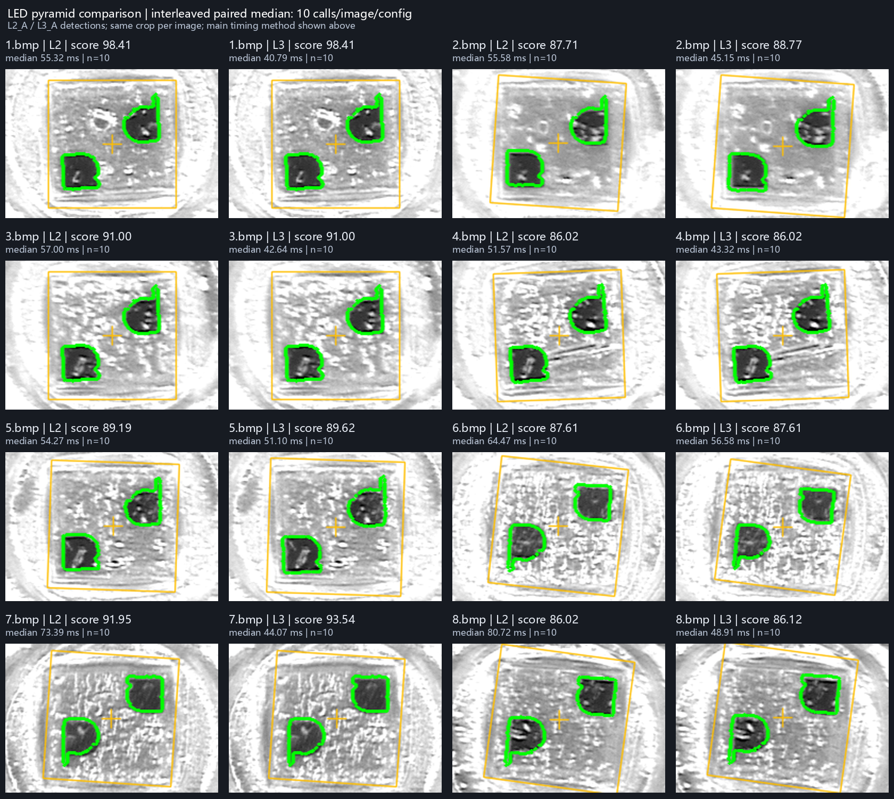

# LED 两层与三层金字塔对照

当前耗时依据：**同进程逐图逐次交替测试（主结果）**。

两层平均匹配耗时 **61.541 ms**，三层 **46.571 ms**；两层/三层耗时比 **1.321×**（大于 1 表示三层更快）。
由平均匹配耗时换算的 FPS：两层 **16.25**，三层 **21.47**。这不是完整应用的帧率。

## 方法

每图、每配置先预热 1 次，不计入 timings.csv；然后同一进程中做 10 组正式测量。repeat 为偶数时先 L2 后 L3，奇数时先 L3 后 L2。每图每配置对 10 条原始计时取 statistics.median，再对 8 个图像中位数取算术平均。每图另计算 10 个同 repeat 的 t2/t3 比值的中位数供对照，它不等于平均耗时之比。

timings.csv 的所有原始记录、分数与候选数以及各组 results.csv、run_config.json 全部保留在 summary.json。下表分数、中心和局部图仍来自 L2_A、L3_A；耗时使用上述当前方法。paired 存在时，原 ABBA 数据与计算结果单独放入 abba_diagnostic，交替测试数据放入 paired。各组完整参数以 run_config.json 为准。

本实验不提供置信区间。交替测量可减轻缓慢漂移对相邻配置比较的影响，仍不能排除系统噪声。匹配计时不含图像读取、模板生成、补边、绘图和结果保存。

## 逐图结果

| 图像 | L2 分数 | L3 分数 | 分数差 L3−L2 | 中心距 px | L2 ms | L3 ms | 耗时比 L2/L3 |
|---|---:|---:|---:|---:|---:|---:|---:|
| 1.bmp | 98.41 | 98.41 | 0.00 | 0.00 | 55.322 | 40.785 | 1.356 |
| 2.bmp | 87.71 | 88.77 | 1.06 | 3.16 | 55.579 | 45.149 | 1.231 |
| 3.bmp | 91.00 | 91.00 | 0.00 | 0.00 | 57.002 | 42.643 | 1.337 |
| 4.bmp | 86.02 | 86.02 | 0.00 | 0.00 | 51.572 | 43.320 | 1.190 |
| 5.bmp | 89.19 | 89.62 | 0.42 | 1.41 | 54.275 | 51.102 | 1.062 |
| 6.bmp | 87.61 | 87.61 | 0.00 | 1.41 | 64.470 | 56.581 | 1.139 |
| 7.bmp | 91.95 | 93.54 | 1.59 | 2.00 | 73.391 | 44.074 | 1.665 |
| 8.bmp | 86.02 | 86.12 | 0.11 | 2.00 | 80.718 | 48.910 | 1.650 |

## 交替样本与 A 组分数核对

实际逐条比较 paired 的 best_score 与同图、同层数 A 组 score，以绝对差 ≤0.01 分作为基本相同的检查标准；这只容许 CSV 舍入差异，不是质量评价标准。
全部 160 条分数均可比较且在容差内。

| 图像 | 成对 t2/t3 中位数 | L2 对 A 最大绝对分差 | L3 对 A 最大绝对分差 | L2/L3 容差检查 |
|---|---:|---:|---:|---|
| 1.bmp | 1.324 | 0.0000 | 0.0000 | 通过 / 通过 |
| 2.bmp | 1.190 | 0.0000 | 0.0000 | 通过 / 通过 |
| 3.bmp | 1.325 | 0.0000 | 0.0000 | 通过 / 通过 |
| 4.bmp | 1.170 | 0.0000 | 0.0000 | 通过 / 通过 |
| 5.bmp | 1.093 | 0.0000 | 0.0000 | 通过 / 通过 |
| 6.bmp | 1.178 | 0.0000 | 0.0000 | 通过 / 通过 |
| 7.bmp | 1.628 | 0.0000 | 0.0000 | 通过 / 通过 |
| 8.bmp | 1.666 | 0.0000 | 0.0000 | 通过 / 通过 |

## 原 ABBA 时间漂移诊断

原 ABBA 汇总：两层 87.253 ms，三层 56.304 ms，耗时比 1.550×。这些参考数字保留以便审计。
原始计时后段存在明显时间漂移，L2_B 最后 3 图、L3_B 第 8 图尤为明显。**不能把原约 1.55 倍作为精确、可依赖的提升结论**；ABBA 运行顺序并未消除本轮漂移。交替数据存在时，上面的主结果使用交替测量重新计算。

| ABBA 组 | 图像 | 7 次原始耗时范围 ms |
|---|---|---:|
| L2_B | 6.bmp | 77.500–206.623 |
| L2_B | 7.bmp | 185.197–295.932 |
| L2_B | 8.bmp | 207.093–272.246 |
| L3_B | 8.bmp | 130.801–165.154 |

N/A 表示未匹配或没有可比较的数据；未匹配图在对照图中标红。中心距是两次检测中心的欧氏距离，不是真实定位误差。

## 解释与限制

- **1.bmp 是模板源图**；SMD 内的原图对应其 x=389、y=225、184×184 裁剪区域，其余 7 张才是独立于模板源的正样本。
- 这些图像均为正样本；没有负样本或完整人工标注，不能据此验证误检率、召回率或普遍准确率。
- 分数表示轮廓相似度，**不是概率**；不同金字塔层数会改变分数，分数变化本身不能证明检测质量改善。
- LED 轮廓对称且使用无符号梯度，角度存在约 180° 的对称歧义；comparison.csv 的角度差已折回 [−180°, 180°)，但仍不能当作真实角度误差。
- 局部图围绕两配置检测中心的平均位置，使用同一裁剪区域放大 2 倍；图中保留各次结果的标记。
- SMD 读取仅针对本次提供文件的已验证布局，不代表支持所有 SMD 版本。

复现汇总：`python artifacts/led_pyramid_compare/compare_results.py`（先完成四组运行；如有 paired/timings.csv 则自动采用交替耗时为主结果；需要 Pillow）。
