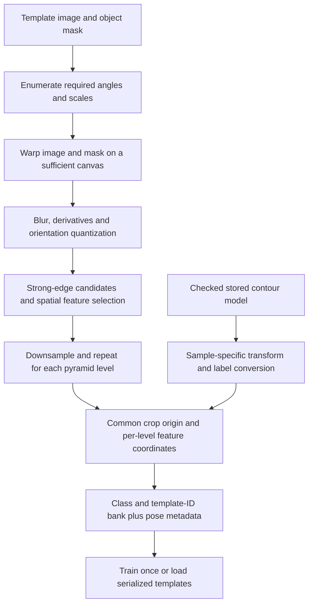
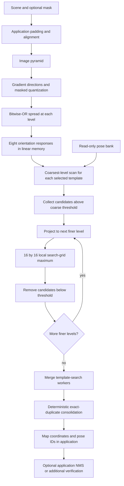

# Architecture and algorithm guide

[English](architecture.md) | [简体中文](architecture.zh-CN.md)

This library locates rigid objects by comparing sparse template features with a scene's gradient directions. Its reusable work is image preprocessing; its repeated work is searching a bank of discrete poses. Understanding that division helps identify which changes can save time without changing the detections, and which changes require a new accuracy evaluation.

This article describes the public **V11 matching core retained in v0.1.1**. The release's documentation and examples do not promote later local research into the production matcher. For build and API usage, start with the [README](../README.md); for reproducible photographs, use [Matching real LED and magnetic parts](matching-examples.md).

## Source map

| Module | Responsibility and useful entry points |
| --- | --- |
| [line2Dup.h](../line2Dup.h) | Public `Feature`, `Template`, `Match`, `Detector`, `MatchWorkspace`, `MatchOptions` and `MatchTimings`; pose enumeration through `shapeInfo_producer`. |
| [line2Dup.cpp](../line2Dup.cpp) | Gradient quantization, image-based template extraction, template cropping and serialization, pyramid preprocessing, coarse search and local refinement. Follow `Detector::match`, `matchClass`, `addTemplate` and `cropTemplates`. |
| [line2Dup_spread.hpp](../line2Dup_spread.hpp) | Separable bitwise-OR spreading with the original zero-outside-image semantics. |
| [line2Dup_response.hpp](../line2Dup_response.hpp) | `ResponseLUT`: immutable direction-response table and fused response lookup/linear-memory construction. |
| [line2Dup_search.hpp](../line2Dup_search.hpp) | Score normalization and first row-major integer maximum selection. |
| [line2Dup_local.hpp](../line2Dup_local.hpp) | SSE row-register accumulation and maximum selection over a 16 × 16 local search patch. |
| [line2Dup_matches.hpp](../line2Dup_matches.hpp) | Deterministic grouping, representative selection and final ordering of duplicate candidates. |
| [MIPP](../MIPP/mipp.h), [CMakeLists.txt](../CMakeLists.txt) | SIMD abstraction, optional OpenMP, library/example targets and installation. |
| [examples/match.cpp](../examples/match.cpp) | Image-based training, query padding, coordinate conversion and a synthetic localization check. |
| [examples/showcase.cpp](../examples/showcase.cpp) | Sample-specific stored-contour import, pose-bank construction, full-bank padding preflight, timings and result overlays. |

The original project follows the LINEMOD approach. This repository derives from [meiqua/shape_based_matching](https://github.com/meiqua/shape_based_matching); its precise imported upstream revision is unverified. See [Source provenance](source-provenance.md) and [third-party notices](../THIRD_PARTY_NOTICES.md).

## Offline: build a bank of template pyramids

A template layer stores integer feature coordinates, an orientation label, its cropped extent, its crop offset `tl_x/tl_y`, and its pyramid level. A template ID identifies a complete pyramid within a class. It does not intrinsically encode an angle or scale; the application must retain that mapping.



`Detector::addTemplate` computes a template at every configured level. The image path uses a 7 × 7 Gaussian blur, Sobel derivatives, squared gradient magnitude and quantized orientation. With three-channel input, it chooses the gradient of the channel having the strongest magnitude at each pixel; it does not build a color descriptor.

Quantization keeps pixels above the weak gradient threshold when at least five votes in their 3 × 3 orientation neighborhood agree. Template extraction then uses the stronger magnitude threshold, a 5 × 5 local suppression procedure and a scattered-feature selection heuristic. An eroded object mask restricts eligible pixels. The current code does not reduce the mask to its silhouette alone: the subtraction that would do so is commented out.

The requested feature count is a selection target, not a promise that every stored layer contains exactly that many features. The image-based extractor halves that target on each pyramid descent, and can fail when too few usable candidates remain. Imported contour banks can contain substantially more features. Always inspect `layer.features.size()` when budgeting work or interpreting scores.

`cropTemplates` obtains a shared extent in full-resolution coordinates, then shifts each layer's features into its cropped coordinate system. Keep the crop offset: the returned feature origin is not automatically the origin of the original training image. Stored dimensions follow the source's max-minus-min convention; the simple example adds one when drawing the inclusive feature-pixel rectangle.

Rotation and scale are covered by discrete bank entries. Common construction choices are:

- Transform the source image and mask, then call `addTemplate` for each pose. This recomputes the image features and must preserve the intended canvas, interpolation and mask conventions.
- Use `addTemplate_rotate` for rotations of an in-memory template with its required orientation information. It rotates existing feature coordinates and directions; it does not re-extract image gradients or provide general scale coverage.
- Import explicitly stored contours, as the showcase does for its two verified SMD layouts. Its transform, direction conversion and crop alignment belong to that adapter. It is not a general SMD/CAD importer.

The feature serialization stores `x/y/label`, but not `theta`, which `addTemplate_rotate` needs. Build rotated entries from the in-memory image-trained template before saving; loaded YAML features do not guarantee equivalent later rotation. `Detector::read` also reconstructs the default gradient modality rather than restoring all written training parameters. Save the training settings, pose and geometry metadata your application needs. Loading a bank for matching is distinct from restoring the complete training state. More poses increase coverage and also increase bank construction, storage and online search work. A smaller angular step is not a measured localization improvement until tested.

## Online: preprocess once, search every selected pose



Each pyramid level uses its own stride `T`. The input dimensions at that level must be divisible by `T`. Images are downsampled by two; masks use nearest-neighbor resizing. A mask suppresses scene gradient pixels before spreading. It is not a dedicated search-origin ROI or a guarantee that a whole returned object lies inside the mask.

### Directions, spreading and the lookup table

Angles are first quantized into 16 bins over 360°, then folded with `& 7`. The eight stored labels therefore represent **unsigned directions with 22.5° spacing over 180°**. Opposite gradient polarities share a label. This can help with contrast reversal, but loses a cue needed to disambiguate some symmetric objects and poses roughly 180° apart.

A quantized scene pixel contains either no orientation or one orientation bit. Spreading collects bits from a forward `T × T` neighborhood:

```text
S[y,x] = OR Q[y+dy,x+dx],  0 <= dx,dy < T
```

Samples outside the image contribute zero. This is an OR of direction bits, not a grayscale maximum, average or contour dilation with a learned kernel. The separable implementation computes the same result with horizontal and vertical passes.

For template label `q`, the response `R_q` takes the best compatibility among the labels present in `S`. The frozen lookup table uses:

| Circular label distance | Contribution |
| --- | ---: |
| Same label | 4 |
| One adjacent label, including wraparound | 3 |
| Other labels, or no direction | 0 |

Several scene directions do not add multiple contributions to one feature: the table takes their maximum. The fast `ResponseLUT` precomputes all 256 masks × eight template labels from the existing table. It changes how the responses are produced, not their values. Changing the bins, weights or neighborhood changes the scoring model and requires new detection-quality validation.

### Why linear memory matters

For each orientation, the response image is permuted into `T²` contiguous rows. A row corresponds to a phase `(x mod T, y mod T)`; its entries visit pixels at stride `T` in both axes. Feature lookup chooses the phase row and starts at `(feature.x / T, feature.y / T)` in the decimated image.

As a template slides by `T` pixels, its feature responses become contiguous streams. The matcher can sum those streams with SIMD instead of gathering unrelated pixels for every location. The fused response path writes this final arrangement directly, avoiding intermediate full-image response maps. All eight linear memories still contain eight bytes per scene pixel per level; gradient buffers, spread buffers, candidates and worker scratch add memory beyond that.

### The score and its limits

For a layer with **actual stored feature count** `N`, internal search-grid origin `u`, feature offsets `f_i` and feature labels `q_i`:

```text
raw(u)   = sum over i of R_q_i(u + f_i)
score(u) = (raw(u) * 100.f) / (4 * N)
```

Each feature contributes at most four, so the normalization gives a 0–100 score for legal inputs. Features skipped by the existing boundary checks still remain in `N`; the denominator is not recomputed from visible or valid features. The implementation preserves the float operation order because threshold rounding is observable.

This score measures directional support near the template's features. It is not a probability, calibrated confidence, contour distance, object-overlap score or one-to-one assignment. Extra scene edges are not directly penalized. Different features may obtain support from the same local scene structure. Clutter, partial shape agreement and repeated patterns can consequently receive high scores.

The internal grid origin in the equation differs from the reported coordinate by the source's spread-centering offset:

```text
offset = T / 2 + (T % 2 - 1)       // integer arithmetic
reported_position = grid_index * T + offset
```

The coarse scan collects scores **strictly greater than** the threshold. Finer-level filtering removes scores **less than** the threshold, so an equality reached during refinement survives. Keep this distinction in an equivalent implementation. Applications should supply a finite threshold in the documented 0–100 domain.

### Coarse-to-fine search and duplicate consolidation

Every selected pose is scanned at the coarsest level. A surviving position is projected to the next finer level using the existing `2 * position + 1` convention, clamped to the available refinement interval, and searched over a 16 × 16 grid. These are 256 candidate positions separated by that level's `T`, not a 16 × 16 patch of adjacent full-resolution pixels. Each layer replaces the candidate's score and position; the final score is not an average of scores from different pyramid levels.

With fewer than 64 features, an 8-bit accumulator suffices because the maximum raw sum is 252. Larger supported layers use 16-bit accumulation; the core requires fewer than 8,192 features per layer. For a positive maximum, the local maximum selects the first row-major winner on ties. An all-zero patch retains score zero and row/column `-1`; at a threshold of zero, refinement's equality rule can retain that result. Treat this as a boundary case, not a localized target. The SSE fused path accumulates one row in registers and selects its maximum without repeatedly writing the entire local score map. Other dispatch conditions retain the existing path.

Template searches can run in parallel. After merging, V11 consolidation groups exactly equal `(class_id, x, y, float score)` records and retains the smallest template ID. Final order is score descending, then template ID, class ID, `y` and `x` ascending. It does not merge nearby positions, different scores or overlapping boxes. **Returned candidate count is not object count.** Application NMS needs its own box geometry, same/cross-class policy and tests for adjacent parts and symmetric poses.

## Coordinates, padding and concurrency are part of the contract

`Match.x/y` describe the cropped feature-template origin in the image passed to `match`, including any application padding. A feature overlay uses that origin plus the layer's feature offsets. To recover an original training-canvas origin, subtract `tl_x/tl_y`; then account for training padding or the adapter's pose transform. To recover original scene coordinates, subtract the query's left/top padding. An object center or rotated object box additionally requires application geometry. The showcase's yellow model region is not ground truth.

Alignment alone does not guarantee a feasible refinement window. At each refinement level, the clamp interval requires:

```text
scene_extent_at_level >= template_extent_at_level + 16 * T_at_level
```

Check width and height for **every bank pose and every refinement level**. For power-of-two pyramids, the corresponding full-resolution requirement scales by `2^level`. Also satisfy divisibility at each level; a multiple of the least common multiple of `2^level * T_at_level` is a sufficient alignment choice. The showcase checks its complete bank and aligns to 32 pixels for `{4,8,8}`. A fixed margin copied from one sample is not a guarantee for another bank. This geometric preflight is not a general proof of all SIMD patch reads for arbitrary custom templates.

Use one `MatchWorkspace` per concurrent call or worker. It reuses allocations, not previous frame results: each call refreshes image, mask, gradients and responses, and does not retain caller-owned input `Mat`s. Workspaces can be reused serially across detectors and moved, but not copied. The legacy overload uses a thread-local workspace.

Keep the detector's templates and modality parameters immutable while matching. Do not train, load or change the modality's gradient thresholds or feature settings on a detector being read concurrently. The similarity threshold passed to `match` is a per-call argument. The library leaves OpenCV and OpenMP thread counts to the application. Coordinate inner OpenMP search with camera-level concurrency to avoid oversubscription. Different frames need separate workspaces even when they share a read-only bank.

## What is optimized now

The default `MatchOptions` enable these existing paths:

| Option | Current effect |
| --- | --- |
| `separable_spread` | Equivalent horizontal/vertical bit-OR spreading. |
| `fused_response` | Response lookup directly into linear memory. |
| `reuse_buffers` | Reuse preprocessing allocations across calls. |
| `integer_local_max` | Compare integer sums and normalize the winning value. |
| `direct_8bit_search` | Avoid an unnecessary 8U-to-16U conversion for small templates. |
| `reuse_search_buffers` | Reuse per-OpenMP-worker candidate and score scratch. |
| `fused_local_search` | Use the SSE fused local kernel when its dispatch conditions hold. |

`MatchTimings` separates pyramid, gradient, spread, response, optional linearization, preprocessing, search and total time. Fused response already includes linearization; do not count it twice. Search includes final consolidation. Measure complete application latency separately from these library stages.

These are implementation changes with retained comparison paths, not a promise that each option speeds up every workload. The work roughly consists of preprocessing proportional to pyramid area, a coarse scan proportional to pose count × coarse feature count × coarse search positions, and local refinement proportional to surviving candidates × features × 256 positions. Final sorting also matters when clutter creates many candidates. Profile the actual bank and scene before choosing an optimization target.

The standalone `line2Dup_local_cache.hpp` is not connected to the public match path or installed as a production component. Later ordered-contour verification, candidate-budget planning, independent mathematical references and byte-codec prototypes are local research. They do not change this release's production score or verify its returned candidates. Synthetic module tests do not establish complete real-data replay, detection accuracy or deployment readiness.

## Relation to OpenCV alternatives

| Approach | What it compares | When the distinction matters |
| --- | --- | --- |
| OpenCV `matchShapes` | Contour/image shape descriptors based on Hu moments. | Useful after obtaining suitable shapes; it does not perform this library's full-image pose-bank gradient search. Segmentation quality and descriptor ambiguity become central. |
| OpenCV `matchTemplate` | A dense raster template against translated image windows using a selected intensity/correlation difference measure. | Useful when appearance is stable. General rotation/scale coverage still needs additional handling; it does not provide this sparse gradient-response pyramid pipeline. |
| This library's LINEMOD-style matcher | Sparse orientation features against spread scene responses, using linear memory and coarse-to-fine search. | Useful when edge layout is more stable than texture, with explicit pose coverage and application-specific validation. |

LINEMOD is the architectural lineage, not an assertion of API or result identity with OpenCV's `linemod` module. The public implementation here uses a single color-gradient modality, including its grayscale path. It is not the full RGB-D multimodal detector, and does not use depth surface normals. OpenCV supplies image operations and storage; the matching, local kernels and candidate consolidation are implemented in this repository.

## What the photographs establish

The [published example run](matching-examples.md) searched eight LED and seven magnetic-part photographs. At threshold 75, all eight and all seven respectively returned at least one candidate. The banks contained 900 and 3,060 poses, with three levels and strides `{4,8,8}`. Highest non-source-image scores were 86.02–93.54 for LED and 89.70–99.49 for magnet.

On the documented Windows i5-13500HX / GCC 15.1 / OpenCV 4.12 / SSE4.1 configuration, with OpenCV one thread and OpenMP four threads, the mean of per-image median complete `match` times was 35.395 ms and 25.459 ms respectively. Each image had one warmup and five measured calls with a reused workspace. Image loading, bank construction, padding and output were excluded. These are historical descriptive measurements, not new measurements for this article, universal latency guarantees or speedup ratios.

Two images are template-source self-checks; the other 13 were also used during development. The examples have no sealed holdout, complete independent pose ground truth or dedicated negative-image evaluation. The magnet bank's wider scale range was chosen after earlier misses on inspected images. Returned candidates above threshold therefore do not establish recall, false-positive rate, subpixel accuracy or calibrated angle/scale accuracy. Unsigned directions and electrode symmetry also explain why a visually plausible LED alignment can have a roughly reversed orientation.

## Improvement paths and the evidence each needs

The following changes are useful investigation directions; none is a claimed gain in v0.1.1. Search terms include LINEMOD response maps, directional chamfer matching, coarse-to-fine pose search, contour topology verification, edge-based pose refinement, SIMD memory bandwidth and early termination with admissible bounds.

| Direction | Starting point | Validation required before claiming improvement |
| --- | --- | --- |
| Faster deterministic consolidation | Profile both sorts and candidate counts in `consolidateMatches`; consider exact-key grouping with bounded ownership. | Compare complete outputs against an independent grouping oracle, including exact float scores, ties, classes and worker merge permutations; measure time and peak memory on large candidate sets. |
| Reuse identical local searches | Identify repeated template/level/center queries; include all response and configuration identity in cache validity. | Compare every candidate with cache disabled, test reset/eviction/concurrency and bound memory; report hit rate and end-to-end timing. The local cache prototype is not evidence of integration. |
| SIMD or GPU kernels | Profile response construction versus local accumulation; preserve unsigned response and accumulator bounds. | Independent byte/scalar oracles, odd sizes, non-contiguous ROI, alignment/tails, ties and all-zero patches; execute tests on each claimed ISA and include transfer/launch costs. |
| ROI and smaller pose banks | Apply genuine process constraints before scanning. | Test scene-coordinate mapping, border objects, range endpoints and missed out-of-range poses; report recall and latency together. An input mask is not the same API. |
| Adaptive feature or pyramid selection | Inspect actual per-layer feature support and candidate survival. | Freeze an evaluation protocol with positives, negatives, clutter and occlusion; compare complete detections. Fewer points or levels change the model and are not automatically equivalent optimizations. |
| NMS and candidate verification | Define object geometry and retain rejected/empty outcomes; evaluate additional contour support or correspondence checks. | One-to-one detection evaluation, neighboring targets, symmetry and occlusion; retain true-positive losses as well as false-positive reductions, and charge all verification work. |
| Continuous pose refinement | Start from discrete candidates and evaluate distance-field or contour registration. | Independent continuous-transform tests plus real annotated measurements, convergence/failure states, symmetry handling, error distributions and added latency. Decimal outputs alone do not establish accuracy. |
| Deployment robustness | Define workspace ownership, allocation limits, model versions and failure reporting. | Long-running multi-camera tests, first-frame and p95/p99 latency, peak resident memory, reload/size-change tests and fault injection; distinguish no match from incomplete search or resource failure. |

Preserve a frozen baseline and validate one change at a time. For an equivalent optimization, compare complete candidate fields and ordering before interpreting timings. For a scoring or search-policy change, add detection-quality evaluation on data excluded from tuning. Kernel equality, recognition accuracy, runtime and deployment reliability answer different questions and need separate evidence.
