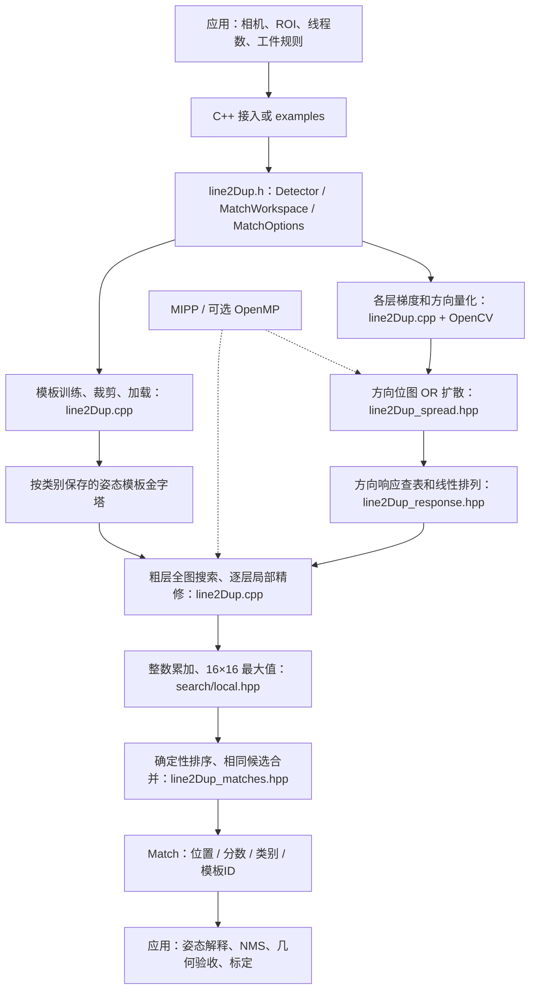
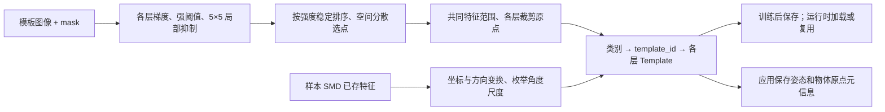
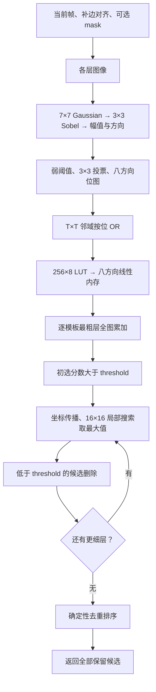
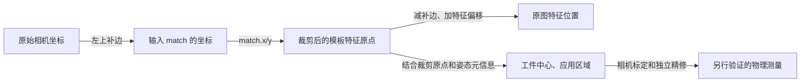

# 架构与算法：从轮廓特征到匹配结果

[English](architecture.md) | [简体中文](architecture.zh-CN.md) | [返回 README](../README.zh-CN.md)

本文对应 **v0.1.1 的公开 C++ 实现**。匹配核心保持已验证的 V11；本版整理真实图像示例、使用方式与设计说明，没有引入尚未验证有效的轮廓验证器。目标是说明当前程序如何工作，以及继续提升速度和准确率时应研究什么。

## 1. 算法实际匹配什么

模板由一组稀疏特征 `(x, y, label)` 组成。`label` 是八类无向梯度方向之一；在线搜索时，把这些特征放到不同位置，累加场景中相应方向的响应。位置、方向布局都吻合时，分数较高。

这里的“轮廓”主要表示**边缘的空间布局**。生产核心没有将每条边组织成有序曲线，没有轮廓拓扑、孔洞对应、边缘一对一分配或物理尺寸测量约束。目标的外边缘、孔洞和内部纹理都可能提供梯度特征。因此，杂乱背景中的多条不相关边缘也可能共同形成高分。

LED 示例直接使用所提供 SMD 中的两电极特征；磁片示例使用外形和中心孔特征。输入场景是提供的真实照片，模型文件保持原样。示例中的 SMD 读取器仅支持两个已检查的布局，并不是通用工业视觉模型解析器。

## 2. 完整模块关系



| 文件 | 主要职责 | 阅读入口 |
| --- | --- | --- |
| [line2Dup.h](../line2Dup.h) | 对外结构、Detector、工作区、配置和计时 | `Feature`、`Template`、`Match`、`MatchOptions` |
| [line2Dup.cpp](../line2Dup.cpp) | 模板提取、梯度、金字塔、搜索、模型读写 | `extractTemplate`、`Detector::match`、`matchClass` |
| [line2Dup_spread.hpp](../line2Dup_spread.hpp) | 可分离方向位 OR 扩散 | `spreadSeparable` |
| [line2Dup_response.hpp](../line2Dup_response.hpp) | 查表并直接写入重排后的响应 | `ResponseLUT::linearize` |
| [line2Dup_search.hpp](../line2Dup_search.hpp) | 整数分数转换、局部最大值 | `similarityScore`、`localMaximum` |
| [line2Dup_local.hpp](../line2Dup_local.hpp) | SSE 行寄存器累加和首次最大值选择 | `localMaximum16x16` |
| [line2Dup_matches.hpp](../line2Dup_matches.hpp) | 去重与确定性顺序 | `consolidateMatches` |
| [examples/match.cpp](../examples/match.cpp) | 单模板训练、补边、匹配和集成自检 | `main` |
| [examples/showcase.cpp](../examples/showcase.cpp) | 两个 SMD 样本、姿态库、全库补边检查、实拍结果 | `SampleDetector`、`preflight`、`geometry` |
| [CMakeLists.txt](../CMakeLists.txt) | 静态库、示例、SIMD/OpenMP、安装包 | `shape_based_matching` target |

构建和运行以上路径不依赖 Python。本地研究、验证脚本和大数据集不属于发行内容。

## 3. 离线阶段：建立模板库



常规图像训练使用 `Detector::addTemplate`：每层先提取足够强且方向稳定的梯度候选，在 5×5 邻域做局部抑制，再按强度稳定排序，用距离约束挑选分散特征。mask 在提取时经过腐蚀，当前代码并未把它变成只剩外边界的环，因此 mask 内部的强梯度也能被选中。

`num_features` 是选点过程的目标，**不是最终数量的硬上限**。选点循环按完整候选轮次判断，可能超过目标；后续评分和耗时分析必须使用实际保存的特征数。金字塔下采样时目标数量减半，但不能据此推断实际每层点数。

`cropTemplates` 将各层范围映射到原始层，求共同特征范围，并记录各层裁剪原点 `tl_x, tl_y`。因此 `Match.x/y` 对应的是裁剪后特征原点，不等于原模板图像左上角。

旋转和缩放通过**姿态模板库**覆盖。示例中 LED 为 180 个角度 × 5 个尺度 = 900 个模板；磁片为 180 × 17 = 3,060 个模板，每个模板有三层。特征坐标和方向一起变换，模板 ID 与角度/尺度的对应关系由示例保存。单个模板不具备任意旋转、缩放不变性。

核心另有 `addTemplate_rotate` 和图像变换辅助接口；它们与示例直接变换 SMD 特征是不同的建库路径。选择角度步长、尺度范围时，应先确定工件的实际变化范围，再用独立样本验证覆盖率和代价。

**模型读写边界：**当前 `Feature::write/read` 仅保存 `x/y/label`，不保存 `theta`，而 `addTemplate_rotate` 使用 `theta`。应在原图训练后先建立旋转库再保存；不要依赖从 YAML 加载后继续等价旋转建库。`Detector::read` 也未恢复写出的全部梯度训练参数。加载模板用于匹配和完整训练状态回读是不同的保证，应用应另外保存训练配置及姿态元信息。

## 4. 在线阶段：从照片到候选



### 梯度与八方向量化

灰度输入由 Sobel 求导；彩色输入分别求各通道梯度，在每个像素选择幅值最大的通道方向。幅值以平方形式与平方阈值比较。方向先映射到 16 个桶，再通过 `& 7` 折叠为八类，等效于将 180° 相反的梯度视为同方向，桶间隔约 22.5°。3×3 邻域至少五票一致才保留。

无向梯度提高了对边缘明暗翻转的容忍，也丢失了极性信息。LED 两电极等近似对称目标可能存在约 180° 的姿态歧义；提高分数阈值并不能恢复已丢失的信息。

### 扩散与响应图

量化后的像素是方向位掩码。扩散使用：

```text
S[y,x] = OR Q[y+dy,x+dx],  0 <= dx,dy < T
```

越界项为零。这里是有偏移约定的 `T×T` 窗口，不应替换成没有核对锚点的居中膨胀，也不能把按位 OR 改成灰度最大值。可分离实现先水平 OR 再垂直 OR，将遍历量由约 `O(W H T²)` 降为 `O(W H T)`，并保留原结果。

对模板方向 `b`，场景响应取扩散窗口中最合适方向的查表分数。当前 LUT 的单方向响应为：相同桶 4，相邻桶 3，其余 0，方向差按八类环绕计算。多个方向同时存在时取最大值。

默认融合路径用一张 `256×8` 的小表，将扩散位掩码直接转换并写入八个方向的线性内存，避免“先写八幅完整响应图、再读出来重排”的中间流量。**响应计算仍然存在，只是中间表示被融合。**最终只返回坐标/分数，可以省去画图和保存，却不能直接省去这些评分数据。

### 线性内存为什么有用

每个方向的响应数据按 `(y mod T, x mod T)` 分成 `T²` 个相位。每个相位内部沿下采样网格连续存储：

```text
phase  = (y % T) * T + x % T
offset = (y / T) * (W / T) + x / T
```

这样固定模板特征在一串候选位置上的响应可连续读取，适合 SIMD 累加。重排是排列变换，并非只保留 `1/T²` 的像素：每层八个方向的响应载荷合计约 `8 W H` 字节，不含梯度、扩散、工作区等缓冲。多层空间成本为 `8 Σ(W_l H_l)`；尺寸恰好每层减半时，三层约为原图像素数的 `8×1.3125` 字节。

### 评分与金字塔搜索

设当前层实际模板特征数为 `F`，某位置的整数累计响应为 `raw`：

```text
score = (raw * 100.f) / (4 * F)
```

分数归一化到 0～100，表示模板各梯度特征得到的平均支持程度，**不是概率**。被跳过的无效特征仍在分母中；实现不按有效支持点数重新归一化。实现保留原浮点运算顺序；改变阈值比较或转换顺序可能改变边界候选。最粗层初选使用 `score > threshold`，精修后删除 `score < threshold` 的候选，两处相等边界不同。

上式以内部搜索网格原点计算响应；输出坐标另外包含扩散的中心偏移 `offset = T/2 + (T%2 - 1)`，即 `grid_index*T + offset`（整数运算）。各层分数在精修时被替换，最终分数不是跨层分数平均。

最粗层先全图搜索，细层只在每个候选周围检查 16×16 个网格位置，网格间距为该层 `T`，不是相邻原图像素。源码向下一细层映射中心时采用 `2*x+1, 2*y+1`，并根据模板尺寸和 `8*T` 边界进行夹取。正最大值保留行优先遍历遇到的第一个最大点；全零局部块保持分数 0、行列 `-1`，阈值为 0 时可能因精修保留相等分数而留下该结果，应视为边界情况，不能解释为已定位目标。粗层没有留下的目标，细层无法凭空恢复；增加金字塔层数并不保证既更快又更准。

每层少于 64 个特征时使用 8 位累加，因为最大值为 `4×63=252`；64～8191 个特征使用 16 位路径。SSE 默认优化可在行寄存器中完成局部累加与最大值选择，省去中间局部图的写回、再读取。它有后端与配置条件，其它情况走现有路径。

### 候选合并和多目标检测

最终合并键为完全相同的 `(x, y, similarity, class_id)`，保留最小模板 ID，再按确定性规则排序。邻近位置、不同分数或不同姿态的框仍可同时存在。这不是 IoU NMS，返回候选数不等于物体数。

## 5. 坐标、补边与并发接入



例如原图中的一个特征坐标为 `match.x - padding_left + feature.x`；模型中心还需结合裁剪原点、模型尺寸、角度和尺度。具体示例见 `showcase.cpp::geometry`。黄色模型区域是显示几何，不是真值框。

每层输入宽高必须能被该层 `T` 整除。还要给**整套模板库**留出细层精修空间，不能仅按原始零角度模板补边。示例对所有姿态、所有精修层检查：

```text
padded_extent >= (template_extent_l + 16*T_l) * 2^l
```

三层示例采用 32 像素对齐；具体对齐要求随金字塔和 `T` 设置变化。应先做此类全库检查，再判断“算法完全识别不到”是否由边界和尺度覆盖问题引起。

`MatchWorkspace` 复用每层预处理缓冲及每个搜索线程的候选/累加缓冲，减少逐帧分配。每次匹配仍刷新图像和 mask 数据，工作区不是跨帧图像结果缓存。每个并发调用应独占一个工作区；模板不变时 detector 可共享只读匹配，训练和加载不要与匹配并发。OpenCV 与 OpenMP 线程数由应用设置，要避免外层多帧并行与内部并行叠加导致争抢。

## 6. 与 OpenCV 几种常见方法的区别

| 方法 | 输入/主要评分对象 | 适用情形与区别 |
| --- | --- | --- |
| `findContours` + `matchShapes` | 先得到轮廓，再比较 Hu 矩描述量 | 适合能可靠分割出轮廓的情况；`matchShapes` 本身不在整幅图上滑动定位 |
| `matchTemplate` | 模板像素块与图像窗口的相关或差值 | 原图单姿态滑窗直接；旋转尺度覆盖需另行处理，对灰度/纹理变化的响应也不同 |
| OpenCV LINEMOD | 方向量化、响应与模板金字塔等思路 | 本项目属于该算法家族的派生实现；不是当前 OpenCV 接口的简单包装，不能推断数值完全相同 |
| 本项目 v0.1.1 | 稀疏方向特征、扩散响应、姿态库、金字塔搜索 | 可直接在杂边场景中找候选，但无完整曲线对应、拓扑验证或连续姿态精修 |

这些方法可能组合使用：本项目快速提议位置，之后在小 ROI 做边缘或几何验证。后一级验证只有通过独立误检/漏检评估后，才能宣称提高了准确率。

## 7. 当前速度证据应怎样理解

现有[实拍示例](matching-examples.md)在 i5-13500HX、Windows、GCC 15.1 Release/SSE4.1、OpenCV 4.12 单线程、OpenMP 四线程下记录了：

| 场景 | 原图 / 补边后 | 模板数 | 各层特征数 | 每图中位耗时的平均值 |
| --- | --- | ---: | --- | ---: |
| LED | 768×576 / 896×704 | 900 | 236 / 111 / 46 | 35.395 ms |
| 磁片 | 640×480 / 896×832 | 3060 | 1214 / 605 / 301 | 25.459 ms |

这些是已有一次运行的完整 `detector.match` 耗时，包含预处理、搜索、排序和去重，排除加载、建库、补边、绘图和保存；不是本版新增的加速收益，也不是节拍保证。共 15 张开发图，其中两张是模板来源图；没有独立真值、留出测试或专门负样本评估，因此不能把“15 张都有高分候选”写成 100% 准确率。

上游示例中的“1024×1024、响应图 60 ms、360 模板 7 ms”是另一套配置下的分段记录。模板层数、实际特征数、阈值、尺度库、杂边、候选精修数量、CPU 和线程数不同，就不能直接比较。上游来源也未精确定位到导入快照的提交，详见[来源说明](source-provenance.md)。

预处理大致随各层像素数增长。最粗层搜索大致随“模板数 × 该层实际特征数 × 扫描位置数”增长；精修还随保留候选数和细层点数增长，候选排序也有成本。模板多、低阈值或杂边多时，搜索完全可能超过响应构建的占比。只测内层加法不能代表整次调用更快。

`MatchTimings` 可记录 `gradient_ms`、`spread_ms`、`response_ms`、`linearize_ms`、`preprocess_ms`、`search_ms`、`total_ms`。融合路径的 `response_ms` 已包含线性重排，`linearize_ms` 为零；`search_ms` 包含排序和去重。原有日志中的 `construct response map` 实际打印整个预处理时间，分析时应优先使用细分字段。

## 8. 现有优化与后续研究方向

当前生产核心已启用可分离扩散、响应/重排融合、预处理和搜索工作区复用、少特征的 8 位路径、整数局部最大值、条件适用的 SSE 融合精修、OpenMP 模板搜索和确定性候选合并。配置开关见 `MatchOptions`；改变开关用于比较时，先核对完整候选列表，再比较完整调用耗时。

本地尚未完成真实质量验证的有序轮廓验证器、场景索引、证据压缩器和其它研究代码不属于本版生产路径。数学检查通过只证明指定测试域中的实现性质，不等于实拍召回率或误检率提高。

| 研究方向 | 可能收益 | 必须同时验证的代价/风险 |
| --- | --- | --- |
| ROI、机械运动范围与合理姿态范围 | 减少像素、模板和候选 | 越界、极值姿态、换型时漏检 |
| 分层角度/尺度库、保守候选剪枝 | 减少全库粗搜及精修 | 原有真阳性是否全部保留；不能用任意 top-k 掩盖漏检 |
| 空间分布与判别性更好的特征 | 降低点数和相似背景支持 | 弱边、遮挡、材质和光照变化下的召回 |
| 响应数据布局、SIMD 与批处理 | 降低内存流量和循环开销 | 端到端收益、缓存、尾部、溢出和后端一致性 |
| 工作区预热与线程调度 | 减少分配/争抢，稳定延迟 | 冷启动、并发帧、尾延迟、峰值内存 |
| 候选后的方向距离、曲线顺序、孔洞/几何一致性 | 减少杂边拼成的高分 | 遮挡真阳性损失、阈值泛化、额外耗时 |
| 小 ROI 内连续位姿/亚像素精修 | 提高定位与角度精度 | 独立位置/角度真值、光学变化、标定误差 |
| 边缘极性或非对称标记 | 缓解 180° 歧义 | 明暗翻转、反光和无标记工件的适用性 |

建议检索方向包括：LINEMOD response maps、coarse-to-fine template matching、directional chamfer matching、edge based pose refinement、contour topology verification、SIMD memory bandwidth、early termination with admissible bounds。以上是研究入口，不代表已集成或必然优于当前实现。

后续评估应分别回答三个问题：输出是否与基线等价；有真值的正、负样本上召回率、误检数和定位误差是否改善；相同硬件和线程设置下完整调用及尾延迟是否改善。按工件、采集批次和场景划分开发与留出数据，冻结参数后再看留出结果，并保留失败样本。速度与准确率需要分别量化。

## 9. 复现与来源

构建、安装和 API 用法见 [README](../README.zh-CN.md)。真实样本来源、参数、每图结果、计时范围和输出解释见[实拍示例说明](matching-examples.md)。`match_example --synthetic` 是程序集成自检，README 图片使用真实场景。

项目继承自 [meiqua/shape_based_matching](https://github.com/meiqua/shape_based_matching)，沿用 LINEMOD 相关思路，使用 OpenCV 和 MIPP。精确导入提交未确定，BSD-2-Clause 及依赖声明保留，见 [LICENSE](../LICENSE)、[THIRD_PARTY_NOTICES.md](../THIRD_PARTY_NOTICES.md) 与[来源记录](source-provenance.md)。
